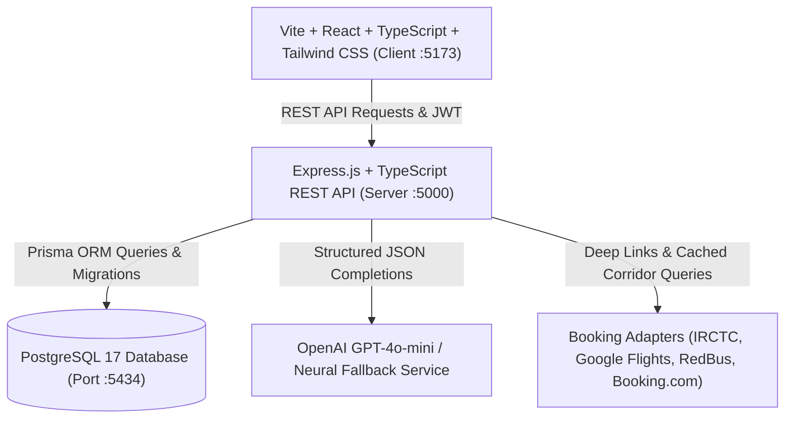

# 🧭 TravelXP

> **Every destination has a story. Every journey has a memory.**  
> *Explore places. Experience cultures. Preserve stories. Travel smarter.*

TravelXP is a full-stack, AI-enabled cultural travel and discovery platform centered on India. Unlike generic travel websites, TravelXP weaves together five deeply connected experiences:
1. **Discover:** Interactive map of India with custom marker classifications, regional navigation, and personalized destination scoring.
2. **Book:** Dedicated booking discovery hub with authorized provider integrations and deep links (Google Flights, IRCTC, RedBus, Booking.com, MakeMyTrip).
3. **Plan:** AI-assisted multi-step itinerary architect producing realistic day-by-day schedules with sightseeing duration, transit buffers, meal pauses, and rest-aware pacing.
4. **Know:** Cultural and archaeological knowledge explorer clearly distinguishing verified history, scriptural accounts, religious traditions, and regional folklore with citation provenance.
5. **Stories & Heritage:** Living multilingual oral memory archive preserving stories in English, Hindi (हिन्दी), Marathi (मराठी), and Bhojpuri (भोजपुरी), with separate non-destructive translation storage.

---

## 🏛️ System Architecture



---

## 🚀 Quick Start Guide

### 1. Prerequisites
- **Node.js**: v20+ or v24+
- **PostgreSQL**: 17+ installed locally or via cloud (Neon, Render, Supabase)
- **Git**

### 2. Database Setup
A dedicated PostgreSQL 17 cluster is initialized for TravelXP on port 5434:
```bash
# Push Prisma schema to PostgreSQL
npm run db:push --prefix server

# Seed initial dataset (24 curated Indian destinations, attractions, stories, citations)
npm run db:seed --prefix server
```

### 3. Running the Backend Server
```bash
# In one terminal:
cd server
npm run dev
# Server starts at http://localhost:5000 (Health check: http://localhost:5000/api/v1/health)
```

### 4. Running the Frontend Client
```bash
# In another terminal:
cd client
npm run dev
# Client starts at http://localhost:5173
```

---

## 🔑 Environment Configuration

Create `.env` in `server/` (see `server/.env.example`):

```ini
PORT=5000
NODE_ENV=development
DATABASE_URL="postgresql://postgres@localhost:5434/travelxp"
JWT_SECRET="travelxp-super-secure-jwt-secret-key-2026-production-ready"
SESSION_SECRET="travelxp-session-secret-2026"
FRONTEND_URL="http://localhost:5173"
API_BASE_URL="http://localhost:5000/api/v1"

# External Integrations (Optional credentials)
GOOGLE_CLIENT_ID=""
GOOGLE_CLIENT_SECRET=""
OPENAI_API_KEY=""
EMAIL_PROVIDER_API_KEY=""
EMAIL_FROM="noreply@travelxp.local"
GOOGLE_MAPS_API_KEY=""
```

*Note: In the absence of an OpenAI API key or external credentials, TravelXP provides transparent, high-fidelity offline neural fallback generators and authenticated provider search links.*

---

## 🧪 Automated Testing

Run the automated backend test suite powered by Vitest and Supertest:
```bash
npm run test --prefix server
```

### Actual Test Results
```text
✓ GET /api/v1/health should return 200 and healthy status (PostgreSQL active)
✓ GET /api/v1/destinations should return seeded destinations
✓ GET /api/v1/destinations/map should return markers with color classifications
✓ POST /api/v1/bookings/flights/search should return cached provider results with deep links
✓ POST /api/v1/trips/generate should produce realistic day-by-day time plan and budget breakdown
✓ GET /api/v1/stories should return multilingual community stories

Test Files  1 passed (1)
Tests       6 passed (6)
```

---

## 🎨 Cultural Blue Visual Identity

| Token | Hex | Role |
| :--- | :--- | :--- |
| **Midnight Indigo** | `#102A43` | Primary headers, dominant interfaces, and contrast backgrounds |
| **Heritage Blue** | `#174A7E` | Secondary brand navigation and subtle borders |
| **Ocean Blue** | `#246BCE` | Interactive primary CTAs, links, and curated marker badges |
| **Sky Blue** | `#D9EAF7` | Accent pill backgrounds and badge tints |
| **Warm Ivory** | `#FAF7F0` | Primary cultural background canvas |
| **Heritage Gold** | `#C89B3C` | Heritage landmark accents, decorative highlights, and stars |
| **Muted Terracotta** | `#B86B4B` | Community memory pin markers and traditional accents |
| **Forest Green** | `#347A55` | Recommended-for-you personalized pin markers |

---

## 📍 Interactive Map Marker Taxonomy

- 🟢 **Green Pin (Recommended for You):** Computed dynamically based on user preferences (interests, budget, pacing).
- 🔵 **Blue Pin (Curated Essential):** Editorial featured destinations chosen for universal cultural significance.
- 🟡 **Gold Pin (Heritage Landmark):** UNESCO World Heritage & ASI protected architectural monuments.
- 🟤 **Terracotta Pin (Local Memory):** Destinations with published oral community recollections.
- 🟣 **Purple Pin (Rich Community Archive):** Destinations with multiple published multilingual stories.

---

## 🛡️ Default Accounts for Testing

- **Curator Admin:** `admin@travelxp.local` / `AdminPass@2026` (Access to `/admin` dashboard)
- **Sample Traveler:** `anamika@travelxp.local` / `TravelXP@2026`

---

## 📄 License
MIT License. Built for cultural preservation, smart itineraries, and Indian travel discovery.
